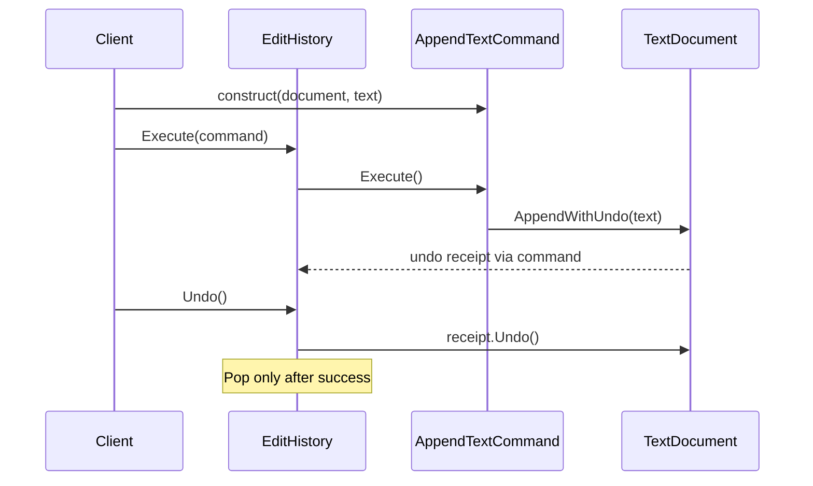

# Command: Deferred Requests and Bounded Undo History

## Requirement and Correct Baseline

A small editor appends text immediately. The [direct editor](../../src/Learning.Patterns.Behavioral/Command/Baseline/DirectEditor.cs)
correctly delegates to a document. A direct call is enough when the caller knows the operation.

The requirement changes: controls should bind requests without editing immediately, a shared
invoker should execute them, and successful edits need bounded, last-in-first-out undo. A growing
editor switch would couple controls, execution policy, and history.

Command represents a request as an object. An append command captures its receiver and text.
Construction has no effect. Each execution returns an undo receipt for that particular edit.
Undo is optional in the wider Command pattern; this lesson explicitly requires it.

## Roles and Source Route

| Role | Source | Responsibility |
|---|---|---|
| Receiver | [TextDocument](../../src/Learning.Patterns.Behavioral/Command/TextDocument.cs) | own text, validate length, restore a matching edit |
| Contract | [IEditCommand / IUndoEdit](../../src/Learning.Patterns.Behavioral/Command/IEditCommand.cs) | execute and return an undo capability |
| Concrete command | [AppendTextCommand](../../src/Learning.Patterns.Behavioral/Command/AppendTextCommand.cs) | capture receiver and immutable text |
| Invoker | [EditHistory](../../src/Learning.Patterns.Behavioral/Command/EditHistory.cs) | bound receipts and undo in reverse order |
| Client | [CommandDemo](../../src/Learning.Patterns.Behavioral/Command/CommandDemo.cs) | compose objects and choose execution time |
| Alternative | [DelegateButton](../../src/Learning.Patterns.Behavioral/Command/ModernCSharp/DelegateButton.cs) | local callback without history |



## Bind Now, Execute Later

```csharp
var document = new TextDocument();
var history = new EditHistory(capacity: 32);
IEditCommand append = new AppendTextCommand(document, "Learn");
history.Execute(append); // Text becomes Learn.
history.Undo();          // Text becomes empty.
```

The command retains its receiver and immutable request data. The invoker retains receipts rather
than reusable commands: executing one command twice creates two distinct edits. The client owns
their lifetimes. Execution is synchronous on the caller's thread; capturing a request does not
create a task, queue, or worker.

## Execution and Failure Contract

- Preserve text exactly, including whitespace and Unicode. Reject empty/null appends.
- Bound documents to 4096 UTF-16 code units, not user-perceived characters.
- Reject oversized input during construction and check the current total at execution.
- Validate before mutation. A failed provided command leaves the document and history unchanged.
- Bound history to 1 through 128 receipts, default 32. Full history rejects before calling the
  command; successful undo frees capacity. Never silently discard an undo entry.
- Reject nested history execution/undo. The busy flag guards reentrancy, not multiple threads.

All collaborators are single-threaded; callers must serialize the complete workflow. Locking just
the stack would not make receiver mutation and history atomic. The command interface is an extension
contract, not a transaction manager. A third-party command that mutates and then throws violates its
atomic requirement; the invoker cannot infer a repair. Process and allocation failures are outside
this in-memory guarantee.

## Undo Ownership and Conflicts

Each append creates a private immutable state object. A receipt remembers the before and after
identities. Undo requires the current state to be that exact after object, restores the before
object, then consumes the receipt.

This supports A, B, undo B, undo A. A monotonically increasing revision alone would reject undo A
after undo B unless the design separately tracked logical history. Comparing text alone would
accept unrelated edits that happen to produce the same characters.

A receipt is single-use. Out-of-order undo fails without mutation; undoing the later edit can
make the earlier receipt valid again. Direct edits outside history cause a conflict. The invoker
keeps the failed receipt and propagates the error rather than overwriting unexpected content.
A conflicting history may stay unusable; resolving or discarding it requires an explicit policy.

Private snapshots are an implementation detail here. The planned Memento lesson will examine
snapshot ownership and encapsulation separately. Receipts retain states until released; document
and history bounds limit this invoker, but callers may retain additional commands/receipts.
There is no redo, persistence, serialization, or cross-process delivery in this lab.

## Repeated Execution and External Effects

Executing the same command twice appends twice. Command does not imply idempotency, deduplication,
exactly-once delivery, or authorization. Local undo does not unsend an email or reverse a payment.
External compensation is a separate operation with its own authorization and failure handling.

CQRS separates read and write models/paths at application scope. A GoF Command object organizes an
individual request at object scope. Neither requires adopting the other.

## Alternatives and .NET Vocabulary

Use a direct receiver call for immediate stable operations. Use an Action callback for a small
local button without history. Captured objects stay reachable while the delegate is retained;
callbacks do not automatically provide inspectable request data or undo.

[System.Windows.Input.ICommand](https://learn.microsoft.com/en-us/dotnet/api/system.windows.input.icommand?view=net-10.0)
provides Execute, CanExecute, and CanExecuteChanged for UI commanding. It supplies neither undo
history nor durable queuing. Our typed contract needs no UI framework. A CanExecute precheck is
useful feedback; execution must still enforce current validity.

Strategy selects how an algorithm runs. Command captures an operation to invoke later. Observer
delivers notifications to subscribers; this invoker executes one request and retains its receipt.

## Run and Verify

From the repository root:

```powershell
dotnet run --project 10-design-patterns/src/Learning.Patterns.ConsoleApp -- --pattern behavioral.command
dotnet test 10-design-patterns/solutions/behavioral.slnx --configuration Release
```

Expected output:

```text
Baseline: Learn .NET
Command: Learn .NET
After undo: Learn
Re-executed: Learn .NET
Delegate: Callback
```

The [23 Command tests](../../tests/Learning.Patterns.Behavioral.Tests/Command/EditHistoryTests.cs)
cover deferred execution, baseline equivalence, LIFO undo, repetition, receipt ownership, capacity,
receiver limits, external conflicts, reentrancy, Unicode, invalid inputs, and deterministic output.
They need no timing assumptions or external provider.

## Exercises and Acceptance Criteria

1. Add replace-text. Preserve limits, capture a receipt per execution, reject conflicting undo,
   and test mixed append/replace undo in reverse order.
2. Design redo first: specify when a new edit clears redo, bound both stacks, and test branching,
   external conflicts, repeated operations, and capacity.
3. Replace a button command with Action. Demonstrate equivalent immediate behavior and explain
   which history/inspection requirements disappeared.
4. Propose a durable request DTO separately. Specify validation, authorization, idempotency key
   ownership, retries, and recovery before introducing persistence.

## References and Navigation

- [GoF catalog and original book](https://www.informit.com/store/design-patterns-elements-of-reusable-object-oriented-9780321770462).
- [Microsoft ICommand API](https://learn.microsoft.com/en-us/dotnet/api/system.windows.input.icommand?view=net-10.0).
- Previous: [Observer](observer.md).
- Next planned topic: State.
- [Delivery ledger](../00-roadmap.md).
