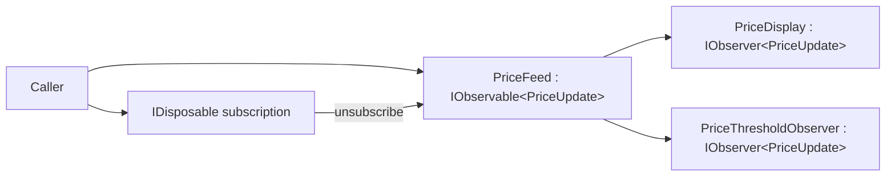

# Observer: Subscription Lifetime and Explicit Delivery Rules

## Requirement and Baseline

A catalog publishes immutable price updates. Initially, one display and one threshold counter always
receive every update. The [fixed publisher](../../src/Learning.Patterns.Behavioral/Observer/Baseline/FixedPricePublisher.cs)
is correct for that requirement: it calls two known concrete consumers directly.

Now screens open and close independently, more consumers may join, and the publisher should not
change every time a new consumer appears. Their subscription lifetimes differ. One broken callback
must not prevent attempts to notify healthy consumers in the current publication.

Observer separates the provider from replaceable subscribers. This implementation uses the built-in
`IObservable<PriceUpdate>` and `IObserver<PriceUpdate>` interfaces and returns an `IDisposable`
subscription. Their signatures do not define every ordering, concurrency, or exception rule. The
additional policies below belong to this example, not to every implementation of those interfaces.

## Collaborators and Source Route

| Role | Source | Responsibility |
|---|---|---|
| Notification | [PriceUpdate](../../src/Learning.Patterns.Behavioral/Observer/PriceUpdate.cs) | immutable product-code/USD snapshot |
| Subject/provider | [PriceFeed](../../src/Learning.Patterns.Behavioral/Observer/Refactored/PriceFeed.cs) | membership, publication, terminal state, and subscription tokens |
| Display observer | [PriceDisplay](../../src/Learning.Patterns.Behavioral/Observer/Observers/PriceDisplay.cs) | keep the latest received snapshot |
| Threshold observer | [PriceThresholdObserver](../../src/Learning.Patterns.Behavioral/Observer/Observers/PriceThresholdObserver.cs) | count received updates at/above a configured threshold |
| Smaller alternative | [EventPricePublisher](../../src/Learning.Patterns.Behavioral/Observer/ModernCSharp/EventPricePublisher.cs) | ordinary synchronous C# event with explicit `+=`/`-=` lifetime |
| Composition | [ObserverDemo](../../src/Learning.Patterns.Behavioral/Observer/ObserverDemo.cs) | fixed baseline, independent unsubscription, and completion |



The publisher shares notification data, not its mutable list. Product codes are trimmed and bounded;
the lab accepts USD values from zero to one million with at most two fractional digits. These are
scenario limits, not a general pricing or money library.

## Subscription Ownership

```csharp
var feed = new PriceFeed();
var display = new PriceDisplay();
using IDisposable screenLifetime = feed.Subscribe(display);
feed.Publish(new PriceUpdate("BOOK-1", 12m));
// Leaving the scope removes this subscription, not every observer.
```

The caller owns the token and the observer's resources. The feed does not dispose an observer as a
resource. Token disposal is idempotent, removes membership, and clears its references to both feed
and observer. Keep the token for as long as notifications are needed; forgetting it can keep a
consumer reachable through the publisher.

Default capacity is 32 active subscriptions, configurable within 1..64. Duplicate active registration
of the same observer object is rejected. After disposing its token, that observer may register again
while the feed remains active. A full budget rejects a new subscription rather than evicting a consumer.

## Snapshot and Concurrency Rules

Subscribe/Dispose protect collection changes with a private lock. A publication snapshots the current
subscriptions and calls observers **outside** that lock. This avoids retaining the membership lock
while executing arbitrary consumer code.

| Situation | This provider's behavior |
|---|---|
| No subscribers | publication succeeds without callbacks |
| Observer unsubscribes itself | later publications omit it |
| Earlier callback removes another token | it is skipped if its callback has not been selected |
| Callback adds a subscriber | new subscriber starts with the next publication |
| Callback was already selected when Dispose runs | it may still run/finish; Dispose does not wait |
| Nested or overlapping Publish/terminal delivery | rejected; there is no hidden queue |

This example traverses a batch in registration order. Do not build business dependencies on an order
provided by `IObservable` in general: other providers may choose differently. The two delivered
observers are independent. Membership synchronization does not make every observer's own state
thread-safe; callers must coordinate consumer resources and reads as their application requires.

Disposal is **not a quiescence barrier**. Unsubscribe before closing a consumer, and use additional
coordination if closing its resources must wait for already selected callbacks. The budget bounds
retained subscriptions and snapshot size, not callback latency, recursion, or user-code memory usage.

## Failure and Termination Are Different

Normal observers should avoid throwing from callbacks. To make the failure requirement explicit,
this provider attempts the remaining batch when a callback does throw, then reports an
`AggregateException` to the publishing caller. It does not roll back callbacks already performed,
retry them, or automatically remove the faulty observer. An ordinary Publish callback failure leaves
the feed active and is **not** translated into `OnError`.

`Fail(error)` means the provider cannot continue the stream. It sends `OnError`; `Complete()` sends
`OnCompleted`. Both commit terminal state and clear active membership before terminal callbacks.
Afterward Publish fails. Repeated terminal requests are no-ops and preserve the original outcome.
If a terminal callback throws, the other current observers are still attempted and the feed stays stopped.

A subscriber arriving after termination receives the saved error or completion **inline in Subscribe**,
without price replay or retained membership. If this late callback throws, that exception propagates
directly from Subscribe. These inline late notifications can run independently of an earlier terminal
batch; do not recursively resubscribe from terminal callbacks or reuse observer state without suitable coordination.

The feed retains no price history, makes no replay/retry promise, and does not use a broker or outbox.
This synchronous in-process collaboration does not provide durable delivery or cross-process recovery.
Use [architecture delivery protocols](../../../11-architecture/docs/05-modules-events-outbox-inbox.md)
when those are the actual requirements.

## C# Events and Other Alternatives

For a small local notification, the event-based alternative may be clearer. Pair registration with
unregistration in `finally` or a well-defined component lifecycle. Ordinary multicast invocation is
fail-fast when a handler throws; it does not inherit this feed's aggregate-failure policy, completion
protocol, capacity, or disposable tokens. The delivered tests make that difference visible.

`IObserver.OnNext` is synchronous and returns no awaitable result. Do not use `async void` callbacks
to imply awaited completion. For async pull, consider `IAsyncEnumerable<T>`; for bounded producer/consumer
work, consider Channels; for richer observable composition, consider a reviewed Rx implementation.
Those are different contracts, not additional features implemented by this lesson.

## Run and Verify

From the repository root:

```powershell
dotnet restore 10-design-patterns/solutions/behavioral.slnx --locked-mode
dotnet test 10-design-patterns/tests/Learning.Patterns.Behavioral.Tests --configuration Release --filter FullyQualifiedName~PriceFeedTests
dotnet run --project 10-design-patterns/src/Learning.Patterns.ConsoleApp -- --pattern behavioral.observer
```

Expected output:

```text
Baseline latest USD: 20.00
Unsubscribed display USD: 12.00
Threshold matches: 1
Active observer completed: True
Late observer completed: True
```

[The suite](../../tests/Learning.Patterns.Behavioral.Tests/Observer/PriceFeedTests.cs) compares the original
fixed-consumer behavior, then exercises individual/duplicate subscriptions, capacity release, membership
changes during callbacks, aggregated errors, terminal state, reentrancy, and the event alternative.
Concurrency cases use explicit gates and timeout watchdogs, not timing sleeps or an assumed winning thread.
The latest-only display and counter are intentionally small consumers, not production UI components.

## Exercises

1. Dispose one subscription while leaving another active. Acceptance: only the remaining observer
   receives the next value, and repeated token disposal is harmless.
2. Subscribe a new observer inside a callback. Acceptance: it misses the current value and receives
   the next one. Explain why snapshotting is not the same as copying mutable publisher state into observers.
3. Inject an OnNext failure. Acceptance: healthy observers are attempted, the caller receives the
   failure aggregate, and no recursive OnError notification is generated.
4. Compare the event alternative. Acceptance: demonstrate explicit unsubscription and its different
   handler-failure behavior without claiming it is a terminal event stream.

All four have reference evidence in the delivered suite. No skipped exercise scaffold represents an
unimplemented future pattern.

## References and Navigation

- [.NET Observer overview](https://learn.microsoft.com/en-us/dotnet/standard/events/observer-design-pattern)
- [IObservable.Subscribe contract](https://learn.microsoft.com/en-us/dotnet/api/system.iobservable-1.subscribe)
- [.NET Observer guidance](https://learn.microsoft.com/en-us/dotnet/standard/events/observer-design-pattern-best-practices)
- Previous: [Decorator](../structural/decorator.md)
- Return: [GoF delivery ledger](../00-roadmap.md)
- Next: [Command](command.md); State remains planned.
