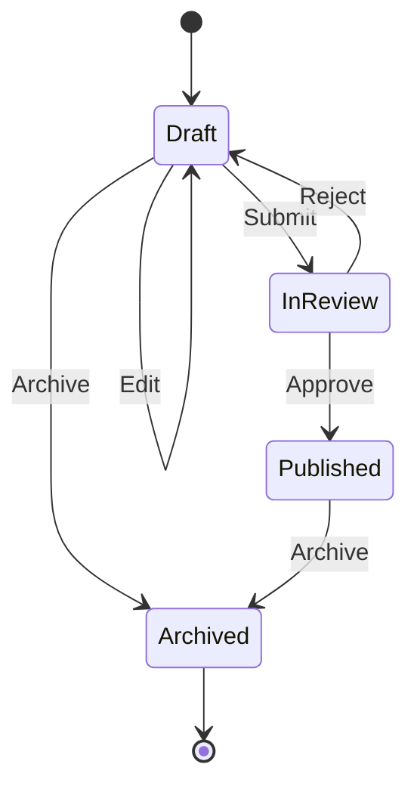

# State: Legal Transitions and Behavior Owned by Lifecycle

## Requirement and Correct Baseline

An article starts as Draft. An editor can revise its title, submit it for review, or archive it.
Review accepts approval or rejection. Approval publishes it; rejection returns it to Draft.
A published article can only be archived, and archived articles accept no further actions.

The [enum/switch baseline](../../src/Learning.Patterns.Behavioral/State/Baseline/SwitchArticle.cs)
is correct for this small closed workflow. A short transition table is often the best final design.

The change pressure for this refactor is to give each lifecycle stage ownership of its permitted
behavior rather than continually extending a central conditional. State delegates operations to
the object representing the current stage. That delegation is the pattern; merely defining an enum
or returning a different status string does not demonstrate it.

## Transition Contract

A dash means InvalidOperationException and no mutation. Illegal operations are rejected, including
repeated Submit, Approve, or Archive. Repeating Edit while Draft is valid.

| Current stage | Edit | Submit | Approve | Reject | Archive |
|---|---|---|---|---|---|
| Draft | Draft; replace title | InReview | — | — | Archived |
| InReview | — | — | Published | Draft | — |
| Published | — | — | — | — | Archived |
| Archived | — | — | — | — | — |



Only Edit accepts a title. It must be nonblank after trimming and at most 80 UTF-16 code units.
The limit applies after trimming; Unicode content is preserved, but a code-unit count is not a
user-perceived character count. Initial titles use the same normalization.

Unknown action values and unexpected title payloads are rejected before lifecycle dispatch.
Thus malformed input raises an argument exception even if that action would also be illegal in
the current stage. Valid input with an illegal transition raises InvalidOperationException.
All provided failures preserve the current title and stage.

## Collaborators and Source Route

| Role | Source | Responsibility |
|---|---|---|
| Vocabulary/view | [ArticleStage, ArticleAction, ArticleSnapshot](../../src/Learning.Patterns.Behavioral/State/ArticleStage.cs) | public actions, stage names, immutable read view |
| Input rules | [ArticleInput](../../src/Learning.Patterns.Behavioral/State/ArticleInput.cs) | shared normalization and shape validation |
| Baseline | [SwitchArticle](../../src/Learning.Patterns.Behavioral/State/Baseline/SwitchArticle.cs) | correct centralized transition table |
| Context and state contract | [ArticleWorkflow](../../src/Learning.Patterns.Behavioral/State/Refactored/ArticleWorkflow.cs) | own current state/title and commit proposed transitions |
| Concrete states | [ArticleStates](../../src/Learning.Patterns.Behavioral/State/Refactored/ArticleStates.cs) | each stage dispatches only its legal actions |
| Client | [StateDemo](../../src/Learning.Patterns.Behavioral/State/StateDemo.cs) | drive both implementations through the same sequence |

The context validates action input, asks its current state for a complete proposed transition, then
assigns title and state. Internal state classes return a next-state reference and title; they do not
mutate the context or call external dependencies. No public SetState method lets callers bypass the
workflow. The client requests Approve; it cannot assign Published directly.

The state catalog is intentionally closed and internal. Adding a new lifecycle stage requires a
coordinated change to vocabulary, transitions, tests, and documentation. State does not eliminate
every modification or guarantee an open plugin model.

## Ownership, Snapshots, and Failure

The context owns per-article title and current-state reference. Concrete state objects are shared
immutable instances: they contain no title, article identifier, or other per-article mutable data.
Sharing them is a local allocation choice, not delivery of the separately planned Singleton lesson.

Snapshots are immutable read views. A caller can create a modified record copy, but cannot feed it
back into the context; there is no restore API. Previously returned snapshots do not change after
editing. Snapshots are not persistence records or proof that a transition was authorized.

State transition proposal and context assignment run synchronously without callbacks or I/O.
The context is single-threaded; two field assignments are not a database transaction or a concurrent
publication guarantee. Callers must serialize access. Persisted workflows additionally need version
checks, transactions, and deliberate recovery behavior.

This lab stores only a bounded title and current stage, with no unbounded transition history. It
has no async operation, cancellation token, retry, timer, role verification, storage, or email.
Approve expresses a legal lifecycle action; a real application must separately authorize reviewers.
Do not infer authorization or idempotency from the pattern.

## Why Keep the Baseline?

For four simple stages, the switch is concise and auditable. The state-object version adds types,
dispatch, and cross-state references. Prefer it when behavior within stages grows enough that local
ownership makes reasoning easier. A data-driven transition table or switch expression may remain
simpler when transitions are nearly all the behavior.

A state-machine library becomes worth evaluating when hierarchical states, guards, entry/exit
effects, visualization, or persistence are actual requirements. Those capabilities require their
own failure contracts; naming a class State does not provide them.

## Compare Nearby Patterns

- Strategy varies an algorithm chosen by a client. Here current lifecycle determines legal behavior
  and subsequent state; the client cannot select an arbitrary strategy to bypass review.
- Command captures an operation for later execution. State decides whether that operation is legal
  now. Wrapping Approve in a Command would not bypass review rules or grant reviewer permission.
- A flag/enum describes state. The State pattern moves stage-specific behavior into collaborating
  objects. Both implementations here keep a public enum for inspection.
- Software architecture governs module/system boundaries. These classes teach object-level
  collaboration and do not introduce services or deployment units.

## Run and Verify

From the repository root:

```powershell
dotnet run --project 10-design-patterns/src/Learning.Patterns.ConsoleApp -- --pattern behavioral.state
dotnet test 10-design-patterns/solutions/behavioral.slnx --configuration Release
```

Expected output:

```text
Submit: baseline=InReview; state=InReview
Reject: baseline=Draft; state=Draft
Edit: baseline=Draft; state=Draft
Submit: baseline=InReview; state=InReview
Approve: baseline=Published; state=Published
Archive: baseline=Archived; state=Archived
Final title: Revised State
```

The [37 State cases](../../tests/Learning.Patterns.Behavioral.Tests/State/ArticleWorkflowTests.cs)
include all 20 stage/action pairs with independently specified expected outcomes. Both baseline
and refactor must satisfy those outcomes, not merely agree with each other. Additional cases cover
rejection/revision, repeat actions, immutable views, independent contexts, title bounds, malformed
actions/payloads, and deterministic output. Tests reach stages using public actions rather than
reflection or a test-only state setter.

## Exercises and Acceptance Criteria

1. Add a Scheduled stage without a real clock. Supply explicit scheduling input, document the new
   table first, and test every stage/action pair plus invalid input without mutation.
2. Introduce reviewer authorization at an application boundary. Verify an unauthorized Approve never
   reaches the workflow, while an authorized request still respects lifecycle legality.
3. Design persisted version checks. Explain two reviewers approving the same revision and assert the
   intended conflict/replay behavior using a real provider before claiming durable correctness.
4. Extend the baseline with one small requirement and compare readability. Explain when you would
   keep the switch instead of adopting state objects.

## References and Navigation

- [GoF canonical catalog and original book](https://www.informit.com/store/design-patterns-elements-of-reusable-object-oriented-9780321770462).
- Previous: [Command](command.md).
- [Strategy comparison](strategy.md).
- [Guided delivery ledger](../00-roadmap.md).
- Next: [Builder](../creational/builder.md).
