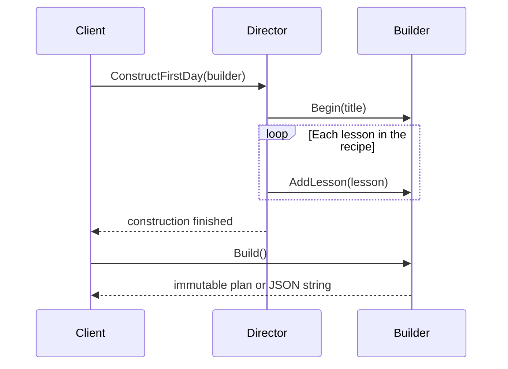

# Builder: Construction Steps, Product Snapshots, and Reusable Recipes

## Requirement and Correct Baseline

The [direct factory](../../src/Learning.Patterns.Creational/Builder/Baseline/DirectPlanFactory.cs)
creates a complete first-day study plan using a validated constructor and a collection expression.
It is correct and concise for one fixed recipe and one product representation.

The requirement changes: clients may assemble plans incrementally, while a reusable first-day recipe
should support both an immutable StudyPlan and a JSON string. The recipe should not know how each
representation is retrieved. Builder separates construction steps from the resulting representation.

This example has a real construction protocol: Begin, repeated AddLesson, and concrete Build.
Method chaining is not required. Returning this from setters alone would not demonstrate the
shared recipe or product-lifetime contract.

## Roles and Source Route

| Role | Source | Responsibility |
|---|---|---|
| Immutable values | [StudyLesson](../../src/Learning.Patterns.Creational/Builder/StudyLesson.cs) | normalized title and valid duration |
| Structured product | [StudyPlan](../../src/Learning.Patterns.Creational/Builder/StudyPlan.cs) | complete validated immutable snapshot |
| Builder contract | [IStudyPlanBuilder](../../src/Learning.Patterns.Creational/Builder/Refactored/IStudyPlanBuilder.cs) | common construction steps |
| Concrete builder | [StudyPlanBuilder](../../src/Learning.Patterns.Creational/Builder/Refactored/StudyPlanBuilder.cs) | retrieve a StudyPlan |
| Other representation | [JsonStudyPlanBuilder](../../src/Learning.Patterns.Creational/Builder/Refactored/JsonStudyPlanBuilder.cs) | retrieve serialized JSON |
| Draft policy | [PlanDraft](../../src/Learning.Patterns.Creational/Builder/Refactored/PlanDraft.cs) | shared bounds, lifecycle, and ownership |
| Director | [StudyPlanDirector](../../src/Learning.Patterns.Creational/Builder/Refactored/StudyPlanDirector.cs) | repeat the first-day construction recipe |
| Client | [BuilderDemo](../../src/Learning.Patterns.Creational/Builder/BuilderDemo.cs) | select builder, invoke recipe, retrieve product |



The common interface omits product retrieval because products have different types. The client
knows which concrete builder it selected and calls that builder's typed Build. A director is optional:
a caller with a custom recipe can call Begin/AddLesson itself.

The JSON builder deliberately reuses the validated StudyPlan snapshot before serialization.
It demonstrates interchangeable representation builders, not streaming JSON or a memory optimization.
The director depends only on construction steps; it never creates a JSON serializer.

## Construction and Ownership Contract

```csharp
var builder = new StudyPlanBuilder();
builder.Begin("Practice");
builder.AddLesson(new StudyLesson("Read tests", 30));
StudyPlan first = builder.Build();
builder.AddLesson(new StudyLesson("Change one behavior", 20));
// first still contains one lesson and 30 minutes.
```

- Begin validates a title, then clears lessons and accumulated duration. Invalid Begin preserves
  the prior draft. The director calls Begin explicitly, replacing any previous draft.
- AddLesson requires Begin, rejects null, and validates budgets before mutation.
- Build requires Begin and at least one lesson. It copies the draft without clearing it.
- Repeated Build returns equivalent snapshots. Later additions or Begin cannot alter an old product.
- Lesson order is preserved and repeated lessons are allowed; titles are not unique identifiers.
- Builders are mutable and single-threaded. Use a separate construction session per caller.
  Products contain immutable lesson values and immutable collections and can be shared read-only.

There is no automatic reset hidden in Build. That policy prevents surprising data loss but means
the caller must use Begin when starting a new plan. The internal draft is not exposed as a product.

## Validation, Bounds, and Failure

Plan and lesson titles must be nonblank, trimmed, and at most 80 UTF-16 code units after trimming.
Lesson duration is 1 through 120 minutes. A plan needs 1 through 12 lessons and at most 480 minutes.
These are learning-scenario budgets, not universal curriculum constraints.

The public StudyPlan constructor enforces the same complete-product invariants and copies its
input collection. Direct construction is supported; callers do not need a builder for a known
complete plan. Its enumeration rejects the thirteenth item without consuming an unlimited sequence.
This bounds item consumption, not the execution time of an arbitrary enumerator.

Malformed values raise argument exceptions. Missing construction steps and exceeded draft budgets
raise InvalidOperationException. Provided operations validate before mutating the draft. Build
does not publish an incomplete product.

The director is a sequence of calls, not a transaction across an arbitrary custom builder. If an
external implementation fails halfway, earlier successful construction steps can remain. A caller
must discard/reinitialize that session or design a separate atomic recipe operation. Process and
allocation failures are outside this lab's validation guarantee.

JSON uses System.Text.Json to encode quotes, newlines, backslashes, and Unicode correctly.
It is an offline product string, not a durable format/version compatibility promise. There is no
I/O, resource disposal obligation for builders, async work, cancellation, or persisted partial draft.

## Simpler C# Alternatives and Pattern Vocabulary

Use a validated constructor and collection expression for a small complete product; the baseline
already does this. Use named arguments to make a few optional constructor inputs readable.
[Object initializers](https://learn.microsoft.com/en-us/dotnet/csharp/programming-guide/classes-and-structs/object-and-collection-initializers)
can initialize accessible properties without a separate builder, and init accessors restrict later
assignment. They do not make a mutable referenced collection deeply immutable.

[Required members](https://learn.microsoft.com/en-us/dotnet/csharp/language-reference/keywords/required)
help the compiler enforce member initialization. They do not validate business ranges, nonblank
strings, or aggregate budgets. Runtime validation still belongs at a deliberate product boundary.

Factory Method varies a product-creation hook inside a creator workflow. This Builder varies a
multi-step construction protocol and its representation through a shared director recipe.
Abstract Factory concerns compatible product families, which remains a separate planned lesson.
Do not infer a full GoF pattern merely from a method named Create or Build.

The extra interface, draft, and concrete builders cost more than the baseline. Keep them only when
incremental assembly or shared recipes across representations justify that cost.

## Run and Verify

From the repository root:

```powershell
dotnet run --project 10-design-patterns/src/Learning.Patterns.ConsoleApp -- --pattern creational.builder
dotnet test 10-design-patterns/solutions/creational.slnx --configuration Release
```

Expected output:

```text
Baseline minutes: 90
Built plan: First .NET day; lessons=3; minutes=90
JSON lessons: 3
Reused builder: Next day
Original snapshot: First .NET day; lessons=3
```

The [28 Builder cases](../../tests/Learning.Patterns.Creational.Tests/Builder/StudyPlanBuilderTests.cs)
verify both representations, valid recipes, missing steps, invalid reset, exact budgets, failed
addition without mutation, independent builders, collection snapshots, bounded enumeration,
serialization of special characters, and deterministic output.

## Exercises and Acceptance Criteria

1. Add a second director recipe. Run it against both builders and compare title, ordered lessons,
   and total duration. Ensure it replaces a previous draft.
2. Add an optional break that counts toward total time. Specify whether it is a lesson or a distinct
   product component before changing the interface; test both representations and budget edges.
3. Compare a staged typed builder with the runtime protocol. Explain which invalid sequences become
   compiler errors and which duration/collection invariants still require runtime validation.
4. Remove the builder from a one-off client. Use the validated constructor and preserve snapshots,
   bounds, and content. Explain why the smaller solution is sufficient.

## References and Navigation

- [GoF canonical catalog and original book](https://www.informit.com/store/design-patterns-elements-of-reusable-object-oriented-9780321770462).
- [Microsoft object and collection initializers](https://learn.microsoft.com/en-us/dotnet/csharp/programming-guide/classes-and-structs/object-and-collection-initializers).
- [Microsoft required members](https://learn.microsoft.com/en-us/dotnet/csharp/language-reference/keywords/required).
- Previous guided topic: [State](../behavioral/state.md).
- [Factory Method comparison](factory-method.md).
- [Delivery ledger](../00-roadmap.md).
- Next planned catalog lesson: Abstract Factory.
