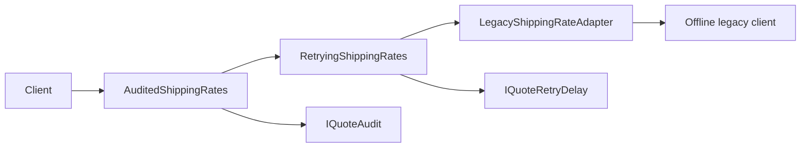

# Decorator: Compose Quote Retry and Required Audit

## Requirement and Change Pressure

Checkout already asks `IShippingRates` for a quote. Some providers return temporary unavailability;
this read-only operation may be attempted again under a small budget. Some callers also require a
completion record before returning the quote. One caller wants only the final result recorded;
another wants every completed attempt recorded.

Start with the correct [fixed workflow](../../src/Learning.Patterns.Structural/Decorator/Baseline/RetryAndAuditQuoteWorkflow.cs).
It retries temporary unavailability and records the final result. Keep that implementation if every
caller needs this exact sequence. Change pressure appears when callers need independent combinations
and ordering. Avoid adding a flag or subclass for every combination.

Decorator keeps the component's interface while adding behavior around a delegated operation. Here
both wrappers implement the existing `IShippingRates`; the client still calls `QuoteAsync`. The
component may already be the [legacy Adapter](adapter.md). Adapter changes an incompatible protocol
into this interface; Decorator keeps that interface and adds responsibility.

## Collaborators and Source Route

| Role | Source | Responsibility |
|---|---|---|
| Component | [IShippingRates](../../src/Learning.Patterns.Structural/Adapter/Contracts/IShippingRates.cs) | quote-only contract and typed outcomes |
| Concrete component | [LegacyShippingRateAdapter](../../src/Learning.Patterns.Structural/Adapter/Refactored/LegacyShippingRateAdapter.cs) | translate the existing offline SDK |
| Retry decorator | [RetryingShippingRates](../../src/Learning.Patterns.Structural/Decorator/Refactored/RetryingShippingRates.cs) | retry only temporary unavailability, with 1..3 total attempts |
| Audit decorator | [AuditedShippingRates](../../src/Learning.Patterns.Structural/Decorator/Refactored/AuditedShippingRates.cs) | await a required record of each result it receives |
| Supporting ports | [IQuoteRetryDelay](../../src/Learning.Patterns.Structural/Decorator/Contracts/IQuoteRetryDelay.cs), [IQuoteAudit](../../src/Learning.Patterns.Structural/Decorator/Contracts/IQuoteAudit.cs) | explicit delay and recording dependencies |
| Runnable composition | [DecoratorDemo](../../src/Learning.Patterns.Structural/Decorator/DecoratorDemo.cs) | offline adapter plus wrappers and recording collaborators |

No decorator base class is necessary for two small wrappers. Each stores its inner component and
implements the same capability directly. Neither owns nor disposes the component, audit, or delay;
their creator controls lifetime. There is no service locator, global registry, background worker, or
decorator-scanning package.



## Ordering Is Observable Behavior

```csharp
IShippingRates finalResultAudit = new AuditedShippingRates(
    new RetryingShippingRates(component, delay), audit);

IShippingRates eachAttemptAudit = new RetryingShippingRates(
    new AuditedShippingRates(component, audit), delay);
```

For a provider returning `TemporarilyUnavailable`, then `Available`:

| Composition | Provider attempts | Required records |
|---|---:|---|
| Audit outside retry | 2 | Available |
| Audit inside retry | 2 | TemporarilyUnavailable, Available |

This is not an interchangeable ordering optimization. Choose the meaning at the composition root
and test it. The wrappers return the component's quote without changing its amount, currency model,
or route outcome. Adding several independently configured retry wrappers can multiply attempts;
configure a single retry owner rather than accidentally nesting budgets.

## Failure, Cancellation, and Bounds

- Total attempts means the initial call plus retries, bounded to 1..3. There is no delay after the
  last permitted attempt, nor after `Available` or `NoRoute`.
- Only the typed `TemporarilyUnavailable` result is retried. Provider, delay, audit, protocol, and
  cancellation exceptions propagate; no catch-all translates them into availability or success.
- The same cancellation token reaches the component, delay, and audit. Wrappers check before the
  call and after an inner result, so a component ignoring cancellation cannot cause a new retry or
  audit after cancellation is observed. Retry also checks again after the delay.
- Audit is a **required completion step**, not optional telemetry. The decorator awaits it; its
  failure fails the operation. Failed provider attempts produce no completion record in this lab.
- Cancellation during an external audit cannot retract a record already accepted. This example
  has no deduplication, transaction, durable audit sink, or exactly-once guarantee.

[FixedQuoteRetryDelay](../../src/Learning.Patterns.Structural/Decorator/FixedQuoteRetryDelay.cs)
supports a positive cancellable delay of at most thirty seconds. Tests and the demo inject controlled
delays instead of sleeping. The demo's immediate simulated waits are intentional for an offline
simulator, not a production retry schedule. A real integration needs a latency budget, backoff/jitter,
provider-specific classifications, and observation. Prefer a reviewed resilience implementation for
a real HTTP client instead of turning this teaching loop into a general retry library.

The inner operation is explicitly **quote-only**. Do not reuse this policy for a booking, charge, or
other mutation without an operation-specific idempotency/recovery protocol. More attempts can repeat
side effects. [Microsoft's HTTP resilience guidance](https://learn.microsoft.com/en-us/dotnet/core/resilience/http-resilience)
explains richer retry configuration and the need to consider unsafe operations.

## Run and Verify

From the repository root:

```powershell
dotnet restore 10-design-patterns/solutions/structural.slnx --locked-mode
dotnet test 10-design-patterns/tests/Learning.Patterns.Structural.Tests --configuration Release --filter FullyQualifiedName~ShippingDecoratorTests
dotnet run --project 10-design-patterns/src/Learning.Patterns.ConsoleApp -- --pattern structural.decorator
```

Expected output:

```text
Baseline USD: 12.99
Decorated USD: 12.99
DE bounded result: TemporarilyUnavailable
Audit records: 2
Retry waits: 2
```

[Behavioral tests](../../tests/Learning.Patterns.Structural.Tests/Decorator/ShippingDecoratorTests.cs)
compare baseline/refactored results, assert order-dependent records, test budgets and terminal results,
and inject provider/audit/delay failures. A controlled completion gate proves audit is awaited. Tokens
are tested before work, during a provider ignoring cancellation, and during a delay ignoring it.
No test depends on wall-clock sleep or an external service.

## Alternatives and Trade-offs

Use the fixed workflow or a direct async function when one caller needs one stable sequence. A local
function/delegate can express the same wrapping for a tiny scope without public wrapper types.
Named decorators become useful when these independently configured behaviors need reusable contracts
and discoverable composition. A DI container can wire them but does not make the ordering correct.

Strategy replaces an algorithm; Adapter translates a contract; Decorator surrounds the same contract;
Proxy usually controls access to a represented object. Similar forwarding syntax does not erase their
different motivations. Middleware and HTTP handlers are related pipeline mechanisms, not a reason to
copy this quote policy indiscriminately into transport code.

Costs include extra call layers, less obvious runtime order, and coupled failure semantics. Required
audit was a deliberate choice here. Best-effort diagnostics would need a separate contract and failure
policy; silently swallowing audit exceptions would change this lesson's requirement.

## Exercises and Acceptance Evidence

1. Move audit inside retry. Acceptance: an unavailable-then-available sequence yields two records
   while the returned quote stays unchanged.
2. Set the budget to one. Acceptance: one unavailable result returns without waiting or a second call.
3. Cancel during the injected delay without making the delay throw. Acceptance: no second provider
   attempt begins, and the public operation observes cancellation.
4. Replace wrappers with a direct local async function for one fixed caller. Acceptance: reuse the
   behavior cases and explain which extension requirement you no longer need.

The first three have reference evidence in the delivered suite. The fourth is an exercise, not a
second production implementation or an unfinished scaffold.

## References and Navigation

- [GoF catalog and structural taxonomy](https://www.informit.com/store/design-patterns-elements-of-reusable-object-oriented-9780321770462)
- Previous: [Adapter](adapter.md)
- Return: [GoF delivery ledger](../00-roadmap.md)
- Next planned topic: Observer, with explicit subscription lifetime and failure semantics.
